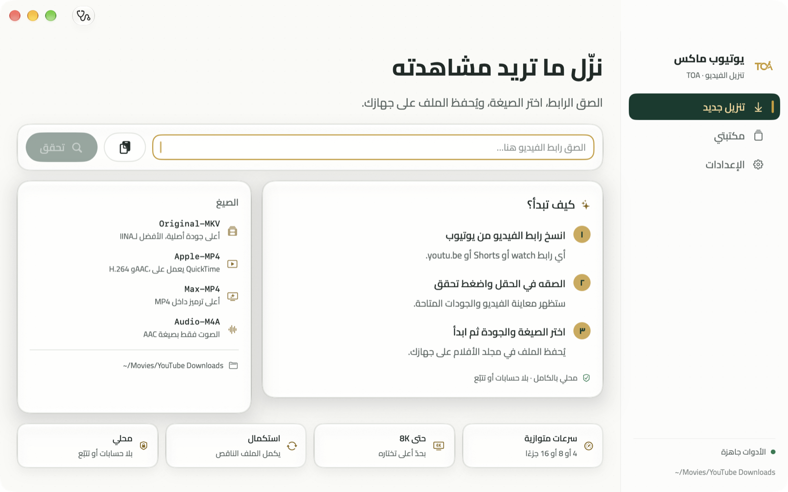

# YouTube Max — macOS

واجهة ماك أصلية (SwiftUI) لتنزيل فيديو واحد من يوتيوب بالجودة والصيغة التي تختارها.
مبنية على `yt-dlp` و`FFmpeg`، بتصميم زجاجي يناسب macOS 27.

مبنية على العمل الأصلي [ikhd/youtube-max-downloader](https://github.com/ikhd/youtube-max-downloader)
لصاحبه **Khalid (ikhd)**، وتستخدم أدواته نفسها. الشكر له على الأساس الذي بُني عليه هذا التطبيق.



## ما يفعله

- لصق رابط `watch` أو `Shorts` أو `youtu.be`، ثم التحقق من الفيديو وعرض معاينته.
- أربع صيغ: Original-MKV، Apple-MP4، Max-MP4، وصوت M4A.
- حدّ أعلى للجودة (حتى 8K) وسرعات متوازية (4/8/16 جزءًا).
- شريط تقدم حقيقي، إلغاء، إعادة المحاولة، ومكتبة محفوظة محليًا.
- الحفظ في `~/Movies/YouTube Downloads` (قابل للتغيير من الإعدادات).

## التصميم

- الألوان معرّفة في `Sources/ToaColor.swift`، وتتبع الوضع الفاتح والداكن تلقائيًا.
- الخط العربي Cairo (SIL OFL) — الرخصة في `Resources/Fonts/Cairo-OFL.txt`.
- شعار التطبيق يُستخدم كما هو، دون إعادة رسم أو تلوين.
- شاشة الانتظار: الشعار يتنفس، وخط ذهبي يرسمه من اليمين، وقوسان ذهبيان يدوران حوله، والنسبة بالأرقام العربية.

## المتطلبات والبناء

```sh
brew install yt-dlp ffmpeg deno
./build.sh
open "build/YouTube Max.app"
```

`aria2c` اختياري لوضع «توربو»: `brew install aria2`.

يتطلب Xcode (أدوات سطر الأوامر). لا ينزّل البناء أي شيء من الشبكة.
التطبيق غير موقّع بشهادة Apple (توقيع محلي ad-hoc)، لذا يُشغّل على الجهاز الذي بُني عليه.

## الخصوصية

يعمل محليًا بالكامل: لا حسابات، لا تتبّع، ولا تحليلات. الاتصالات فقط إلى يوتيوب
(جلب الفيديو) وإلى npm عند حاجة `yt-dlp` لمكوّناته الرسمية EJS.

نزّل فقط ما تملكه أو لديك إذن بتنزيله.

## الرخصة

MIT — انظر `LICENSE` و`NOTICE`.

واجهة ماك مبنية على العمل الأصلي المذكور أعلاه، بموجب رخصة MIT.

يعتمد كذلك على أدوات مفتوحة المصدر: yt-dlp (Unlicense)، FFmpeg (LGPL/GPL)، Cairo (OFL).
